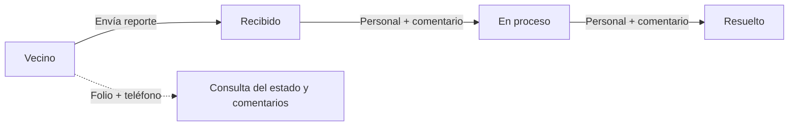
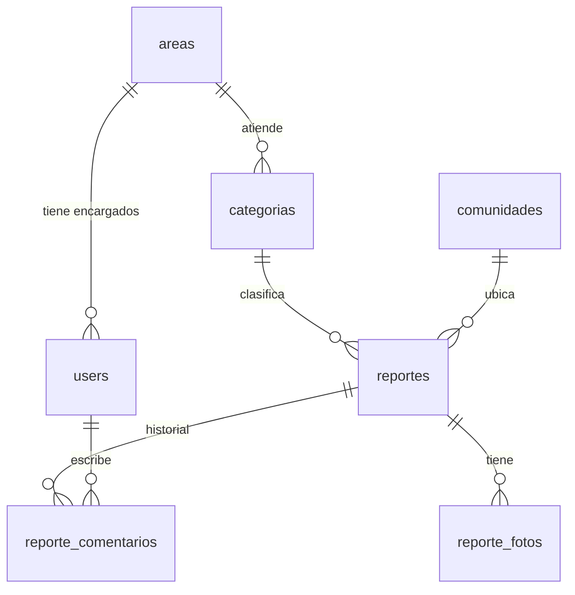

<p align="center">
  
</p>

# Atención Ciudadana

Aplicación web donde un vecino **reporta un problema de su comunidad** (bache, alumbrado, basura o agua) y el personal de la municipalidad **lo atiende desde una bandeja**. El vecino recibe un folio y consulta el avance con ese folio y su teléfono.

Proyecto académico construido con **Laravel 11**, **PHP 8.2** y **MySQL**.

**Demo en línea**

- Portal ciudadano: http://proyectofinaljb.tramitemunicipal.com/
- Administración (bandeja): http://proyectofinaljb.tramitemunicipal.com/login

## Funcionalidades

| Parte | Quién la usa | Qué hace |
| --- | --- | --- |
| Portal público (`/`) | Vecino, sin cuenta | Elige la categoría, describe el problema, sube una foto opcional, elige su barrio o comunidad y deja nombre y teléfono. Recibe un folio `INC-AAAA-NNNNNN`. |
| Consulta (`/consultar`) | Vecino | Con folio + teléfono ve el estado y los comentarios del personal. |
| Bandeja (`/bandeja`) | Personal | Tablero de 3 columnas: **Recibido → En proceso → Resuelto**. Cada cambio de estado lleva un comentario que ve el vecino. |
| Comunidades (`/comunidades`) | Administrador | Agregar, editar y dar de baja barrios y comunidades. |
| Usuarios (`/usuarios`) | Administrador | Crear administradores y encargados de área. |

**Roles:** el *administrador* ve todos los reportes y gestiona usuarios y comunidades. El *encargado* solo ve y atiende los reportes de su área (cada categoría pertenece a un área).

## Flujo de un reporte



## Modelo de datos



| Tabla | Contenido |
| --- | --- |
| `areas` | Áreas que atienden reportes (Mantenimiento, Alumbrado, Agua). |
| `users` | Personal del panel. `tipo_usuario` 1 = administrador, 0 = encargado. |
| `comunidades` | Barrios, colonias, aldeas y caseríos (114 cargados). |
| `categorias` | Bacheo y calles, Alumbrado público, Limpieza y recolección, Agua potable. |
| `reportes` | El reporte del vecino y su `estado` (`recibido`, `en_proceso`, `resuelto`). |
| `reporte_fotos` | Foto del reporte, guardada en disco privado. |
| `reporte_comentarios` | Historial de estados con el comentario para el vecino. |

## Estructura del código

```
app/
  Http/Controllers/
    PortalController.php        Portal público: reportar, folio y consulta
    BandejaController.php       Bandeja del personal: tablero, detalle, cambio de estado, foto
    ComunidadesController.php   Catálogo de comunidades (admin)
    UsuariosController.php      Usuarios del panel (admin)
    Auth/LoginController.php    Inicio y cierre de sesión
  Models/                       Reporte, Categoria, Comunidad, Area, User, ReporteFoto, ReporteComentario
  Providers/
    AuthServiceProvider.php     Permiso "admin"
    RouteServiceProvider.php    Límites de envíos por IP del portal
database/
  migrations/                   Estructura de las 7 tablas
  seeders/                      Áreas, categorías, comunidades, usuarios y reportes de ejemplo
  sql/atencion_ciudadana.sql    La misma base lista para importar en phpMyAdmin
resources/views/
  portal/                       Portal ciudadano (diseño propio, mobile-first)
  auth/login.blade.php          Ingreso del personal
  bandeja/, comunidades/, usuarios/   Panel (AdminLTE 3)
routes/web.php                  Todas las rutas
```

## Instalación local (XAMPP)

Requisitos: PHP 8.2+, Composer y MySQL (XAMPP sirve).

```bash
git clone <url-del-repositorio> C:/xampp/htdocs/atencion-ciudadana
cd C:/xampp/htdocs/atencion-ciudadana
composer install
cp .env.example .env
php artisan key:generate
```

Cree la base de datos `atencion_ciudadana` (utf8mb4) y llénela de **una** de estas dos formas:

```bash
php artisan migrate --seed
```

o importe `database/sql/atencion_ciudadana.sql` en phpMyAdmin.

Abra http://localhost/atencion-ciudadana/. La raíz del proyecto funciona como carpeta pública (el `.htaccess` bloquea todo excepto `index.php` y `public/`). Si usa otra carpeta, ajuste `APP_URL` en `.env`.

### Usuarios de prueba (solo locales)

| Correo | Contraseña | Rol |
| --- | --- | --- |
| `admin@atencionciudadana.test` | `Admin12345` | Administrador |
| `mantenimiento@atencionciudadana.test` | `Encargado12345` | Encargado de Mantenimiento |

Para probar la consulta use, por ejemplo, el folio `INC-2026-000002` con el teléfono `55551002` (los reportes de ejemplo tienen datos ficticios).

## Seguridad

- Consultas con Eloquent o con parámetros enlazados; nada de SQL armado con variables.
- Formularios con token CSRF; todo lo que modifica datos va por POST/PUT.
- Validación en el servidor con mensajes en español y longitudes según cada columna.
- Portal público con límite de peticiones por IP y un campo trampa contra robots.
- Fotos JPG/PNG de máximo 10 MB, guardadas con nombre generado en un disco privado. Solo se muestran por una ruta que valida que el usuario pueda ver ese reporte.
- El reporte se consulta solo con folio **y** teléfono; nunca por id en la URL.
- El encargado no puede abrir reportes de otra área (responde 404) ni las pantallas de administración (403).

## Tecnologías

Laravel 11 · PHP 8.2 · MySQL · AdminLTE 3 (panel) · Bootstrap Icons · CSS propio para el portal.
